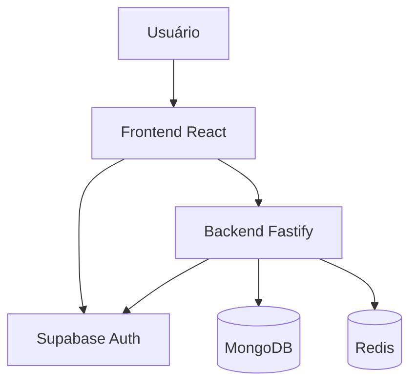

# XTREME SHOP

Aplicação de e-commerce desenvolvida como projeto acadêmico, utilizando uma arquitetura separada entre frontend e backend. O sistema permite visualizar produtos e categorias, consultar detalhes dos produtos, acompanhar o histórico de visualizações e disponibiliza um painel administrativo para gerenciamento do catálogo.

O projeto utiliza **Supabase Auth** para autenticação, **MongoDB** para persistência dos dados e **Redis** para armazenamento temporário do histórico de produtos visualizados.

---

## Sumário

- [Tecnologias utilizadas](#tecnologias-utilizadas)
- [Arquitetura](#arquitetura)
- [Integração entre os serviços](#integração-entre-os-serviços)
- [Funcionalidades](#funcionalidades)
- [Pré-requisitos](#pré-requisitos)
- [Configuração do projeto](#configuração-do-projeto)
- [Executando a aplicação](#executando-a-aplicação)
- [Autenticação e painel administrativo](#autenticação-e-painel-administrativo)
- [Endpoints da API](#endpoints-da-api)
- [Documentação da API](#documentação-da-api)
- [Estrutura de diretórios](#estrutura-de-diretórios)

---

## Tecnologias utilizadas

### Frontend

| Tecnologia     | Finalidade                            |
| -------------- | ------------------------------------- |
| React          | Construção da interface               |
| TypeScript     | Tipagem estática                      |
| Vite           | Ferramenta de desenvolvimento e build |
| React Router   | Navegação entre páginas               |
| TanStack Query | Gerenciamento de requisições e cache  |
| Supabase JS    | Integração com autenticação           |

### Backend

| Tecnologia        | Finalidade                            |
| ----------------- | ------------------------------------- |
| Node.js           | Ambiente de execução                  |
| TypeScript        | Tipagem estática                      |
| Fastify           | Framework HTTP                        |
| MongoDB           | Banco de dados                        |
| Mongoose          | ODM para modelagem e consultas        |
| Redis             | Armazenamento temporário do histórico |
| ioredis           | Cliente Redis para Node.js            |
| Supabase Auth     | Autenticação e validação de usuários  |
| Zod               | Validação de dados                    |
| Swagger / OpenAPI | Documentação da API                   |

### Infraestrutura e ferramentas

- Docker e Docker Compose
- Git e GitHub
- Supabase

---

## Arquitetura

A aplicação utiliza uma arquitetura cliente-servidor, separando a interface gráfica, a API e os serviços de armazenamento.



O frontend é responsável pela interface e pela interação com o usuário. Todas as operações relacionadas aos produtos e categorias são realizadas por meio da API.

O backend centraliza as regras de negócio, valida as requisições, verifica permissões e acessa os bancos de dados.

O Supabase é utilizado como serviço externo de autenticação, enquanto MongoDB e Redis são utilizados para armazenamento persistente e temporário, respectivamente.

---

## Integração entre os serviços

### 1. Supabase Auth — Autenticação

O Supabase Auth é responsável pelo gerenciamento das contas e sessões dos usuários.

O processo de autenticação funciona da seguinte maneira:

1. O usuário informa suas credenciais na tela de login.
2. O frontend envia as credenciais ao Supabase Auth.
3. Após a autenticação, o Supabase retorna uma sessão contendo um Access Token (JWT).
4. O frontend utiliza esse token nas requisições administrativas.
5. O backend recebe o token no cabeçalho `Authorization`.
6. O backend valida o token utilizando `supabase.auth.getUser(token)`.
7. Após a validação, verifica se o usuário possui a permissão administrativa.

O controle de acesso administrativo utiliza o campo `app_metadata.role`, que deve possuir o valor `admin`.

Exemplo do cabeçalho utilizado nas requisições protegidas:

```http
Authorization: Bearer SEU_ACCESS_TOKEN
```

**Importante:** a permissão administrativa é verificada no backend. Ocultar ou exibir elementos no frontend não substitui a validação de autorização na API.

A chave `service_role` do Supabase nunca deve ser exposta no frontend ou versionada no repositório.

### 2. MongoDB — Persistência dos dados

O MongoDB é o banco de dados principal da aplicação.

Ele armazena os dados permanentes do catálogo, incluindo:

- Produtos;
- Categorias;
- Preços;
- Quantidades em estoque;
- Descrições;
- Imagens;
- Estado de ativação dos registros;
- Datas de criação e atualização.

O Mongoose é utilizado para definir os modelos, validar estruturas e realizar operações no banco de dados.

Exemplo simplificado de um documento de produto:

```json
{
  "_id": "ID_DO_PRODUTO",
  "name": "Produto de exemplo",
  "slug": "produto-de-exemplo",
  "description": "Descrição do produto",
  "price": 199.9,
  "stock": 10,
  "categoryId": "ID_DA_CATEGORIA",
  "images": [],
  "active": true
}
```

Os produtos possuem uma referência à categoria correspondente por meio de `categoryId`.

O MongoDB é responsável pela persistência: os dados continuam disponíveis mesmo após a reinicialização da aplicação.

### 3. Redis — Histórico de produtos visualizados

O Redis é utilizado para armazenar temporariamente o histórico de produtos visualizados.

A implementação utiliza uma identificação de visitante gerada no frontend e armazenada no `localStorage` do navegador.

O identificador é enviado ao backend pelo cabeçalho:

```http
x-visitor-id: UUID_DO_VISITANTE
```

Quando um visitante acessa os detalhes de um produto, o backend registra seu identificador no Redis.

A estrutura utiliza uma lista para cada visitante, contendo os identificadores dos produtos visualizados mais recentemente.

As operações utilizadas são:

| Operação | Finalidade                                     |
| -------- | ---------------------------------------------- |
| `LPUSH`  | Adiciona um produto ao início da lista         |
| `LREM`   | Remove ocorrências anteriores do mesmo produto |
| `LTRIM`  | Mantém somente os últimos 10 produtos          |
| `LRANGE` | Recupera os produtos armazenados               |
| `EXPIRE` | Define o prazo de expiração da lista           |

O histórico possui as seguintes características:

- Armazena até 10 produtos por visitante;
- Mantém os produtos em ordem de visualização;
- Evita duplicações na lista;
- Possui tempo de expiração de 30 dias.

O Redis armazena somente os identificadores dos produtos. Os dados completos são recuperados do MongoDB.

Dessa maneira, o Redis funciona como uma camada de armazenamento temporário, enquanto o MongoDB continua sendo a fonte principal dos dados dos produtos.

**Observação:** o identificador de visitante é utilizado para separar históricos entre navegadores. Ele não representa uma identidade autenticada e não deve ser utilizado como mecanismo de autorização.

---

## Funcionalidades

### Catálogo

- Listagem de produtos;
- Visualização dos detalhes de um produto;
- Pesquisa por nome ou descrição;
- Filtragem por categoria;
- Filtragem por faixa de preço;
- Ordenação dos resultados;
- Paginação.

### Histórico de visualizações

- Registro automático dos produtos acessados;
- Identificação individual por visitante;
- Exibição dos últimos 10 produtos visualizados;
- Armazenamento temporário utilizando Redis;
- Expiração automática após 30 dias.

### Painel administrativo

- Autenticação de administradores;
- Proteção das rotas administrativas;
- Cadastro de produtos;
- Atualização de produtos;
- Remoção de produtos;
- Cadastro de categorias;
- Atualização de categorias;
- Remoção de categorias;
- Controle de ativação dos registros.

---

## Pré-requisitos

Antes de executar o projeto, é necessário possuir:

- Node.js 24 ou compatível;
- npm;
- Docker;
- Docker Compose;
- Uma conta e um projeto configurado no Supabase.

Verifique as instalações:

```bash
node --version
npm --version
docker --version
docker compose version
```

---

## Configuração do projeto

### 1. Clonar o repositório

```bash
git clone URL_DO_REPOSITORIO
cd xtreme-shop
```

Substitua `URL_DO_REPOSITORIO` pelo endereço do repositório Git.

### 2. Configurar o backend

Acesse a pasta:

```bash
cd backend
```

Instale as dependências:

```bash
npm install
```

Crie o arquivo `.env`:

```env
NODE_ENV=development
PORT=3333

SUPABASE_URL=https://SEU_PROJETO.supabase.co
SUPABASE_ANON_KEY=SUA_CHAVE_PUBLICA

MONGODB_URI=mongodb://localhost:27017/ecommerce
REDIS_URL=redis://localhost:6379

CORS_ORIGIN=http://localhost:5173
```

Ajuste os valores de acordo com sua configuração do Supabase e do ambiente.

O arquivo `.env` não deve ser enviado ao Git. Utilize `.env.example` para documentar as variáveis necessárias sem expor credenciais.

### 3. Configurar o frontend

Em outro terminal:

```bash
cd frontend
npm install
```

Crie o arquivo `.env`:

```env
VITE_API_URL=http://localhost:3333

VITE_SUPABASE_URL=https://SEU_PROJETO.supabase.co
VITE_SUPABASE_ANON_KEY=SUA_CHAVE_PUBLICA
```

As variáveis com prefixo `VITE_` são disponibilizadas no código do frontend. Portanto, somente informações públicas devem ser configuradas nelas.

---

## Executando a aplicação

### 1. Iniciar MongoDB e Redis

Na raiz do projeto, execute:

```bash
docker compose up -d mongodb redis
```

Esse comando inicia os serviços de banco de dados definidos no `docker-compose.yml`.

Verifique os containers:

```bash
docker compose ps
```

### 2. Iniciar o backend

Acesse a pasta `backend`:

```bash
npm run dev
```

O backend estará disponível em:

```text
http://localhost:3333
```

Verifique o funcionamento:

```text
http://localhost:3333/health
```

### 3. Iniciar o frontend

Em outro terminal, acesse a pasta `frontend`:

```bash
npm run dev
```

O Vite disponibilizará a aplicação em:

```text
http://localhost:5173
```

Acesse o endereço no navegador.

### 4. Executar a infraestrutura com Docker Compose

Também é possível iniciar os serviços de infraestrutura e o backend utilizando:

```bash
docker compose up --build -d
```

Para acompanhar os logs:

```bash
docker compose logs -f
```

Para acompanhar somente o backend:

```bash
docker compose logs -f api
```

Para encerrar os containers:

```bash
docker compose down
```

O frontend pode continuar sendo executado separadamente com `npm run dev`.

---

## Autenticação e painel administrativo

O painel administrativo está disponível em:

```text
http://localhost:5173/admin/login
```

Também é possível acessá-lo pelo link **Painel administrativo** no cabeçalho da página inicial.

Para conceder permissões administrativas a um usuário, é necessário atribuir a seguinte informação em seu `app_metadata` no Supabase:

```json
{
  "role": "admin"
}
```

Essa alteração deve ser realizada por meio de uma operação administrativa segura, utilizando a chave `service_role` exclusivamente no ambiente backend.

Após a configuração, o usuário deve realizar um novo login para obter uma sessão atualizada.

Usuários sem a permissão administrativa não podem executar operações protegidas, mesmo que tentem acessar diretamente os endpoints da API.

---

## Endpoints da API

A API disponibiliza operações para gerenciamento de produtos e categorias.

### Produtos

| Método   | Endpoint                    | Descrição                           |
| -------- | --------------------------- | ----------------------------------- |
| `GET`    | `/products`                 | Lista produtos                      |
| `GET`    | `/products/:id`             | Consulta detalhes de um produto     |
| `GET`    | `/products/recently-viewed` | Consulta histórico de visualizações |
| `POST`   | `/products`                 | Cadastra um produto                 |
| `PATCH`  | `/products/:id`             | Atualiza um produto                 |
| `DELETE` | `/products/:id`             | Remove um produto                   |

### Categorias

| Método   | Endpoint          | Descrição              |
| -------- | ----------------- | ---------------------- |
| `GET`    | `/categories`     | Lista categorias       |
| `POST`   | `/categories`     | Cadastra uma categoria |
| `PATCH`  | `/categories/:id` | Atualiza uma categoria |
| `DELETE` | `/categories/:id` | Remove uma categoria   |

As operações de criação, atualização e remoção exigem autenticação e permissão administrativa.

A listagem e consulta pública devem respeitar as regras de visibilidade dos registros implementadas no backend.

---

## Documentação da API

A documentação da API é disponibilizada por meio do Swagger.

Com o backend em execução, acesse:

```text
http://localhost:3333/docs
```

A interface permite consultar os endpoints, visualizar os parâmetros esperados e testar as requisições disponíveis.

---

## Estrutura de diretórios

A organização geral do projeto é:

```text
xtreme-shop/
│
├── backend/
│   ├── src/
│   │   ├── config/
│   │   ├── infra/
│   │   ├── plugins/
│   │   ├── modules/
│   │   │   ├── categories/
│   │   │   └── products/
│   │   ├── app.ts
│   │   └── server.ts
│   │
│   ├── .env.example
│   ├── package.json
│   └── tsconfig.json
│
├── frontend/
│   ├── src/
│   │   ├── components/
│   │   ├── contexts/
│   │   ├── lib/
│   │   ├── pages/
│   │   ├── services/
│   │   ├── types/
│   │   ├── App.tsx
│   │   └── main.tsx
│   │
│   ├── .env.example
│   └── package.json
│
├── docker-compose.yml
├── .gitignore
└── README.md
```

A estrutura apresentada é uma visão geral e pode ser atualizada conforme novos módulos e funcionalidades forem adicionados.

---

## Considerações finais

O XTREME SHOP utiliza serviços especializados para separar responsabilidades:

- **Supabase Auth:** gerenciamento de usuários, sessões e autenticação;
- **MongoDB:** persistência dos dados de produtos e categorias;
- **Redis:** armazenamento temporário do histórico de produtos visualizados;
- **Fastify:** centralização das regras de negócio e comunicação com os serviços;
- **React:** interface de interação com o usuário.

Essa separação permite manter a aplicação organizada, facilitar a manutenção e possibilitar a evolução independente do frontend, backend e infraestrutura.
